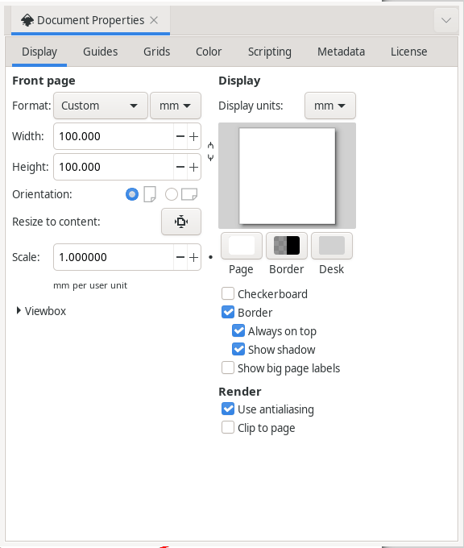
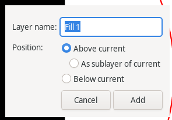
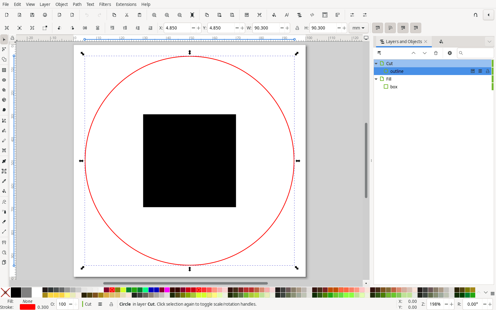
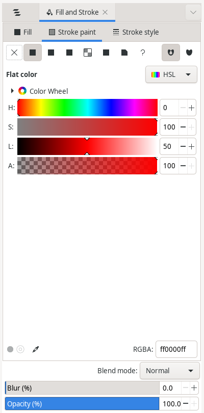
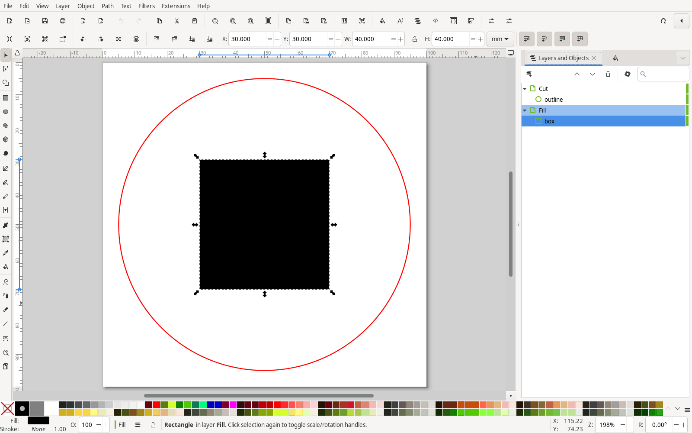
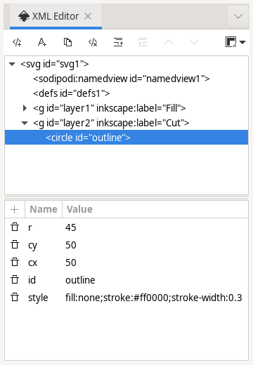
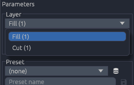
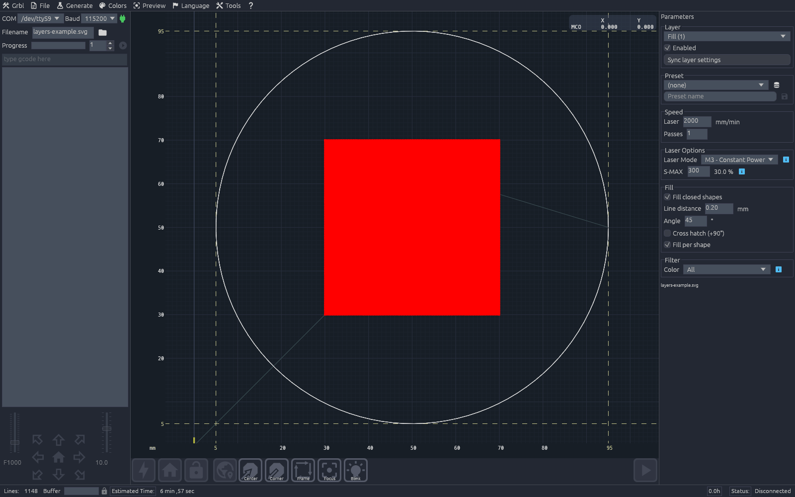
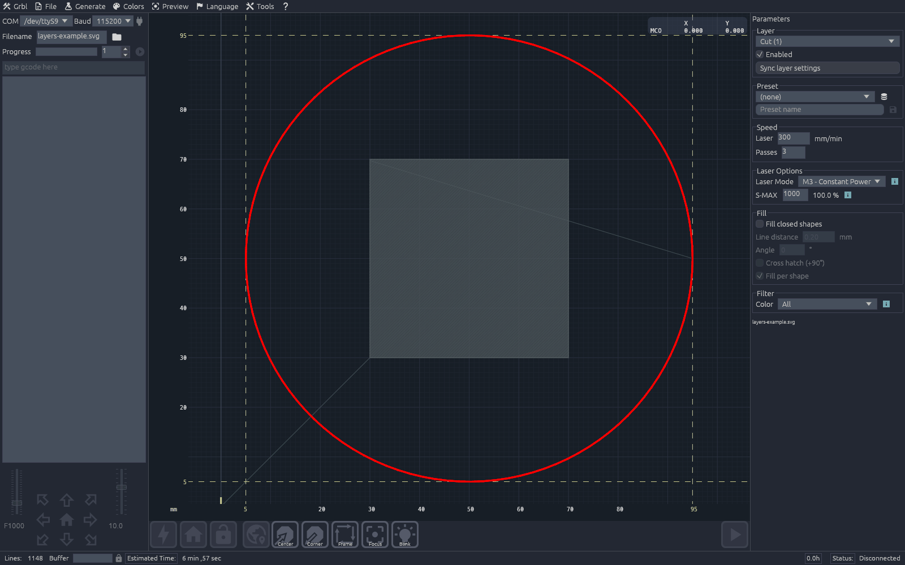

# Manual: multi-layer SVG from Inkscape

L-ai-SERcraft gives every layer of an SVG its own laser settings: speed, passes, power, laser mode, hatch fill
and colour filter. This page shows the workflow with a small example: a circle that is **cut** out and a
black box in its middle that is **engraved** (filled).

Example file: [`manual/layers-example.svg`](manual/layers-example.svg) (100 × 100 mm). Screenshots: Inkscape
1.4 and L-ai-SERcraft.

## How layers are read

* Every **top-level layer** of the SVG becomes one entry in the *Layer* picker of the *Parameters* dock. The
  entry shows the Inkscape layer name and the number of shapes, e.g. `Cut (1)`.
* Sublayers belong to their top-level layer and share its settings.
* Objects outside any layer are collected in the pseudo-layer `(ungrouped)`, which is converted first.
* Layers are converted **in file order**. In the Inkscape *Layers and Objects* panel the file order runs from
  the **bottom** row to the **top** row. Put the cut layer at the top so that it is cut last, after
  the engraving. Otherwise the part may shift or fall out before it is engraved.
* Hidden or locked Inkscape layers **are still converted**. To skip a layer, untick *Enabled* in L-ai-SERcraft.
* Text is not burned. Convert it first with *Path ▸ Object to Path*. Embedded bitmaps are ignored.
* Save as **Inkscape SVG**. *Plain SVG* removes the layer names, so the layers then show up under their ids
  (`layer1`, `layer2`, …).

## 1. Document

*File ▸ Document Properties* (`Ctrl+Shift+D`): set the units to **mm** and the size to the work area you need,
here 100 × 100 mm. Keep *Scale* at 1.0 so that one user unit is 1 mm.

## 2. Layers

1. Open *Layer ▸ Layers and Objects* (`Ctrl+Shift+L`).
2. Rename the default layer to `Cut`: double-click its name in the panel.
3. *Layer ▸ Add Layer* (`Ctrl+Shift+N`): enter the name `Fill`, choose position **Below current** and click *Add*.

Result: `Cut` is above `Fill` in the panel, so `Fill` is engraved first and `Cut` runs last. To change the
order later, drag a layer in the panel or use *Layer ▸ Raise Layer* / *Lower Layer*.

## 3. Cut layer: circular outline

1. Click the `Cut` layer in the panel to make it the current layer.
2. Ellipse tool (`E`). Hold `Ctrl` and drag to draw a circle. For exact values, set `cx = 50`, `cy = 50`
   and `r = 45` in the XML editor (step 5). The X/Y/W/H toolbar includes the stroke width (90.3 mm here).
3. *Object ▸ Fill and Stroke* (`Ctrl+Shift+F`): set *Fill* to none (✕) and *Stroke paint* to a flat colour,
   here red `ff0000ff`. Use a thin stroke (0.1–0.3 mm). The laser follows the centre line, so the stroke width
   only affects the look in Inkscape.

## 4. Fill layer: blackened box

1. Click the `Fill` layer in the panel.
2. Rectangle tool (`R`). Draw a square and set X = 30, Y = 30, W = 40, H = 40 mm in the toolbar.
3. Fill: flat black, stroke: none.

The black fill only shows the intention in Inkscape. L-ai-SERcraft reads the **outline** of the shape and fills
it with hatch lines when *Fill closed shapes* is on for this layer (step 6). Hatch fill needs **closed**
shapes: rectangles, circles, ellipses, polygons and closed paths.

## 5. Check and save

*Edit ▸ XML Editor* (`Ctrl+Shift+X`). Each layer must be a `<g … inkscape:label="…">` **directly** under
`<svg>`, with the shapes inside. `layer1` (Fill) comes before `layer2` (Cut).

Save with *File ▸ Save As…*, type **Inkscape SVG (\*.svg)**.

## 6. Configure in L-ai-SERcraft

Open the file with *File ▸ Open File* or the folder button next to *Filename*. SVGs load directly into the
*Parameters* dock on the right. Pick a layer in the *Layer* box. All other settings in the dock apply to
that layer only.

Example values. Speed and power depend on your laser and material, so test them on scrap first.

| setting | Fill | Cut |
|---|---|---|
| Speed ▸ Laser | 2000 mm/min | 300 mm/min |
| Speed ▸ Passes | 1 | 3 |
| Laser Options ▸ Laser Mode | M3 - Constant Power | M3 - Constant Power |
| Laser Options ▸ S-MAX | 300 (30 %) | 1000 (100 %) |
| Fill ▸ Fill closed shapes | on | off |
| Fill ▸ Line distance / Angle | 0.20 mm / 45° | – |
| Filter ▸ Color | All | All |

The preview draws the selected layer in red.

How the settings behave:

* **The G-code regenerates** after every edit. No apply button is needed. Lines and *Estimated Time* in the
  status bar update with it.
* **Saved per file.** Settings are stored for each SVG file path and come back when the same file is opened
  again.
* **Enabled** off skips the layer. Example: engrave first, check the result, then enable `Cut` only.
* **Sync layer settings** copies the current layer's values, except *Enabled*, to all other layers.
* **Presets:** type a name (e.g. `Cut 3 mm plywood`) in *Preset name* and click the save button. Later, pick the
  preset in the *Preset* box for any layer. The database button opens the preset list.
* **Fill options:**
  * *Line distance* sets the hatch spacing: smaller is darker and slower.
  * *Cross hatch (+90°)* adds a second, perpendicular hatch.
  * *Fill per shape* finishes each shape before moving to the next. Turn it off to hatch row by row
    across the whole layer.
* **Colour filter:** keeps only the shapes of the layer whose stroke colour (or fill colour, when there is no
  stroke) is red, green, blue or black. When the layers already separate the jobs, leave it on *All*.

## Troubleshooting

| symptom | fix |
|---|---|
| only `(ungrouped)` in the Layer picker | the shapes are not in a layer: select them, *Layer ▸ Move Selection to Layer…* |
| layer names show as `layer1`, `layer2` | the file was saved as Plain SVG: save as Inkscape SVG |
| cut runs before the engraving | move the cut layer to the top of the Inkscape panel |
| no hatch lines | *Fill closed shapes* is off for that layer, or the path is not closed (join the end nodes with the Node tool, `N`) |
| text is missing | *Path ▸ Object to Path* before saving |
| a hidden Inkscape layer is burned | hidden layers are converted too: untick *Enabled* in the Parameters dock |
